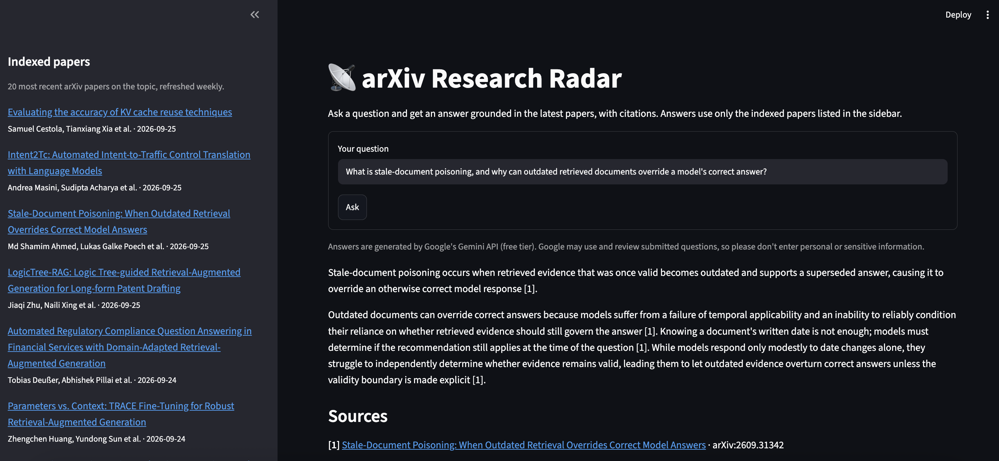
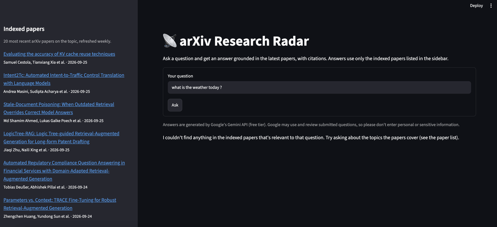
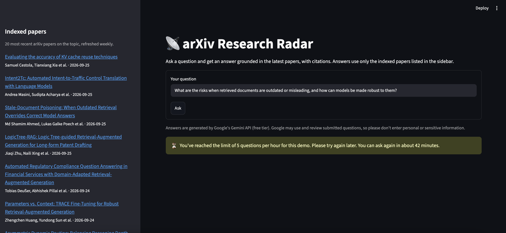
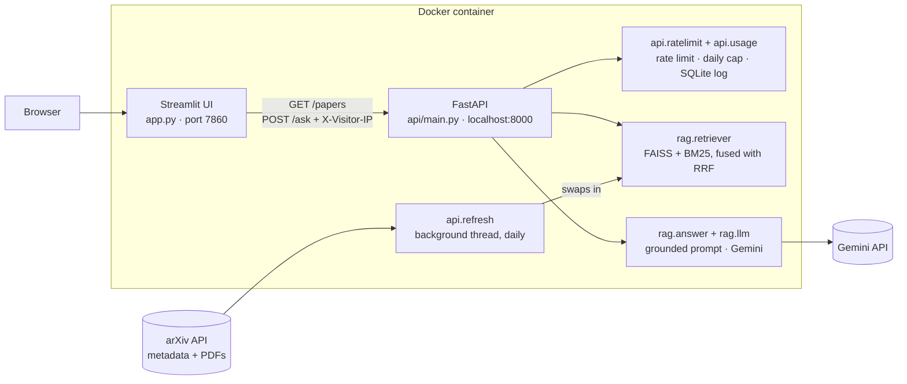
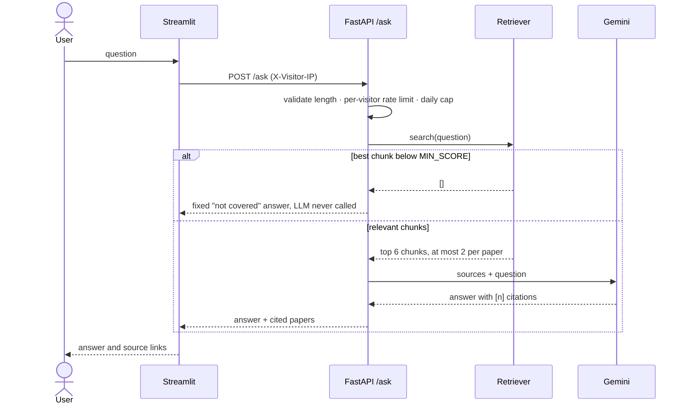

# arxiv-research-radar

[](https://github.com/anastber/arxiv-research-radar/actions/workflows/ci.yml)

A RAG (retrieval-augmented generation) app that answers questions about the latest arXiv
papers on a topic, with citations back to the source papers. The corpus refreshes itself
daily, and every retrieval choice is backed by a benchmark.

Ask "what defenses exist against corpus poisoning in RAG?" and get a short answer with
`[1][2]`-style citations linking to the papers. The model only sees retrieved passages and
is told to say so when they don't cover the question; off-topic questions are turned away
before the model is called.



| Off-topic question: the LLM is never called | Per-visitor rate limit reached |
|---|---|
|  |  |

## Highlights

- **Hybrid retrieval.** Dense embeddings (`all-MiniLM-L6-v2`, exact FAISS search) fused with
  BM25 through Reciprocal Rank Fusion. On the benchmark, the share of questions whose
  relevant paper reaches the model rises from 0.886 to 0.945.
- **Measured, including what didn't work.** A frozen 437-paper benchmark with 139 questions
  scores retrieval (Recall@k, MRR, nDCG) and answers (faithfulness, citation precision,
  relevance, with a calibrated LLM judge). A newer embedding model and two rerankers were
  tested and rejected on the numbers.
- **Self-refreshing corpus.** The API re-fetches the 20 most recent papers every day and
  swaps the new index in without downtime. No live data is stored in the repository.
- **Cost controls for a free-tier LLM.** Per-visitor rate limit, global daily cap, a
  relevance threshold that skips the LLM for off-topic questions, and an output token cap.
- **Small and explicit.** No RAG framework: each stage is a short module you can run on its own.

---

## How it works



### Corpus refresh

`api/refresh.py` rebuilds the corpus in a background thread whenever the index is missing or
older than `REFRESH_HOURS` (default 24):

| Stage | Module | What it does |
|---|---|---|
| Fetch | `ingest/arxiv_client.py`, `ingest/fetch.py` | Lists the `ARXIV_MAX_PAPERS` most recent papers matching `ARXIV_QUERY`, with retry/backoff. Papers already downloaded keep their text, so only new PDFs are fetched. |
| Parse | `ingest/pdf_parser.py` | Extracts PDF text with `pypdf`; falls back to the abstract for scanned or malformed PDFs. |
| Chunk | `rag/chunker.py` | Section-aware chunks of ~160 words (see below). The abstract is its own chunk. |
| Index | `rag/index.py` | Embeds `"{title} \| {section}\n{text}"` per chunk into a `faiss.IndexFlatIP` (unit vectors, so inner product is cosine similarity). |
| Swap | `api/refresh.py` | Builds the index in a staging directory, loads it, then replaces the live retriever. Requests in flight keep the one they started with. |

The corpus is disposable: it is always "the N most recent papers", rebuilt from scratch, so
nothing needs to persist across restarts. A fresh container builds its index on startup
(about two minutes) and `/ask` answers 503 until it is ready. If arXiv is unreachable, the
current corpus keeps being served and the refresh is retried an hour later.

**Section-aware chunking.** Fixed-size chunks tend to separate a method from its
justification. The chunker finds numbered section headings with a regex (and only trusts
them if there are enough of them, covering most of the text), drops the bibliography,
merges very short sections into the next one, and packs whole sentences into chunks with a
one-sentence overlap that never crosses a section boundary.

### Answering a question



**Retrieval.** The question is embedded and matched against the FAISS index, and scored
with BM25 over the same chunk texts. The two rankings are merged with Reciprocal Rank
Fusion, so a passage sharing exact terms with the question (a method name, an acronym)
can surface even when its embedding is not the closest. At most 2 chunks per paper are
kept, so answers draw on several papers.

**Grounding and citations.** `rag/answer.py` groups the chunks by paper inside
`<source id="N">` tags. The system prompt restricts the model to those sources, asks it to
say when they are insufficient, to cite `[N]` after each claim, and to ignore instructions
found inside the papers (the prompt-injection defense). Citations are parsed back out of the
answer, so the returned `cited_papers` are the ones the model actually cited.

**Cost and abuse controls**, in the order they apply:

1. **Validation**: questions are capped at `MAX_QUESTION_CHARS`.
2. **Per-visitor rate limit** (`ASK_RATE_LIMIT`, default `5/hour`, in memory). The UI
   forwards the visitor's IP in `X-Visitor-IP`; the API trusts it because it only listens on
   localhost, behind the UI.
3. **Global daily cap** (`DAILY_CAP`, default 200): an atomic SQLite counter. A failed LLM
   call gives its slot back.
4. **Relevance threshold** (`MIN_SCORE`): if the question's best chunk is below it, the
   answer is a fixed "not covered" message and the LLM is not called.
5. **Output cap** (`MAX_ANSWER_TOKENS`) on the LLM call.

**LLM errors.** `rag/llm.py` turns every SDK error into an `AnswerError` with a `kind`
(`config`, `rate_limit`, `unavailable`, `bad_request`), which the API maps to an HTTP status
and a user-safe message. Internal details only reach the server log.

---

## Evaluation

Quality is measured on a **frozen benchmark**, separate from the live corpus (which changes
daily), so results stay comparable over time.

- **Corpus**: the 437 papers matching the default query submitted between 2026-08-01 and
  2026-09-30, with their parsed text, in `data/eval/corpus.json.gz`.
- **Questions**: 139 accepted questions in `data/eval/questions.jsonl`, drafted by Gemini
  from passages of the corpus: 90 answered by one paper, 20 needing two papers, and 29
  off-topic (12 general, 17 near-domain such as vision or speech). Ground truth is the set
  of relevant papers, so the questions stay valid when chunking changes. The drafting prompt
  forbids naming the system a paper introduces, which would make retrieval a keyword match.
- **Review**: 37 questions were reviewed by hand, the 17 near-domain off-topic questions by
  Claude Opus 5.5; the rest were accepted as drafted.

### Retrieval

Scored at the paper level on the 110 in-scope questions. *Context recall* is the share of
relevant papers present in the context actually sent to the model; the other metrics rank
papers by their best chunk, without threshold.

| Configuration | Recall@1 | Recall@5 | MRR | nDCG@10 | Context recall |
|---|---|---|---|---|---|
| MiniLM, dense (baseline) | 0.700 | 0.891 | 0.836 | 0.847 | 0.886 |
| `bge-small-en-v1.5`, dense | 0.677 | 0.836 | 0.792 | 0.807 | 0.841 |
| **MiniLM, hybrid (BM25 + RRF)**, current | 0.791 | **0.945** | 0.913 | 0.920 | **0.945** |
| `bge-small-en-v1.5`, hybrid | 0.777 | 0.914 | 0.893 | 0.901 | 0.927 |
| MiniLM, hybrid + `ms-marco-MiniLM-L-6-v2` reranker | 0.800 | 0.923 | 0.898 | 0.903 | 0.918 |
| MiniLM, hybrid + `bge-reranker-base` reranker | **0.809** | 0.932 | **0.918** | **0.923** | 0.927 |

- **Hybrid search** is the clear gain. The questions were drafted from passages, which
  favors exact-term matching somewhat, so the gain on real queries may be smaller.
- **`bge-small`** does not beat MiniLM, with or without its query instruction.
- **Reranking** slightly improves the top of the ranking but lowers context recall, and
  `bge-reranker-base` is slow on CPU. It stays off (`RERANK_MODEL` enables it).
- **Threshold.** Near-domain off-topic questions score up to 0.57, above the lowest
  in-scope question (0.50), so no threshold separates them perfectly. `MIN_SCORE=0.45`
  rejects 15 of 29 off-topic questions (5 with the former 0.3) and no in-scope question,
  keeping a margin for real queries.

### Answers

The full pipeline answers every question, and an LLM judge splits each answer into claims
and marks which sources support each one. Measured on the dense baseline
(`MIN_SCORE=0.3`, 12 off-topic questions), with `gemini-3.5-flash-lite` as both answer model
and judge:

| Questions | n | Faithfulness | Citation precision | Relevance | Declined |
|---|---|---|---|---|---|
| single-paper | 90 | 1.000 | 0.997 | 0.847 | 0.156 |
| multi-paper | 20 | 0.989 | 1.000 | 0.900 | 0.050 |
| off-topic | 12 | – | – | – | 1.000 |

- **All off-topic questions are declined**, including the 7 that cleared the threshold: the
  grounding rule catches what retrieval lets through.
- **Declines come from retrieval.** 14 of the 15 declined in-scope answers had the right
  paper in context but not the passage holding the answer.
- **The judge is lenient.** On a 20-answer calibration sample graded by Claude Opus 5.5 (not
  by a human), the judge agrees on 18/20 faithfulness verdicts and 17/19 citation verdicts,
  but every disagreement is the judge missing an overstated claim. Real faithfulness is
  closer to 0.9 than 1.0.

### Running the benchmark

```bash
python -m eval.corpus index          # build the benchmark index (~5 min on CPU)
python -m eval.run --retrieval-only  # retrieval metrics, no API key needed
python -m eval.run                   # retrieval + answer metrics (needs GEMINI_API_KEY)
```

`eval.run` prints both tables and writes a JSON report to `data/eval/results/` with the git
commit, the settings, a hash of the question set and per-question metrics; the numbers above
come from the committed reports. The building blocks have their own entry points:
`eval.questions` (draft and review questions), `eval.retrieval`, and `eval.answers`
(`run`, `report`, `grade`, `calibrate` for the judge).

---

## Running it

### Locally

Requires Python 3.12+ and a free [Gemini API key](https://aistudio.google.com/apikey).

```bash
git clone https://github.com/anastber/arxiv-research-radar.git
cd arxiv-research-radar
python3 -m venv .venv && source .venv/bin/activate
pip install -r requirements.txt
cp .env.example .env                 # then set GEMINI_API_KEY

uvicorn api.main:app --port 8000     # terminal 1
streamlit run app.py                 # terminal 2, opens http://localhost:8501
```

On first start the API downloads the embedding model (~90 MB), fetches the latest papers
and builds its index, which takes about two minutes. `curl localhost:8000/health` reports
`building_index` until then, and `ok` after.

Other entry points:

```bash
python -m rag.answer "what is stale-document poisoning?"   # ask from the CLI
python -m api.usage                                        # query log, daily counts, token usage
python -m ingest.fetch && python -m rag.index              # rebuild the corpus by hand
```

### With Docker

```bash
docker build -t arxiv-radar .
docker run -p 7860:7860 -e GEMINI_API_KEY=... arxiv-radar   # http://localhost:7860
```

One container runs both processes (`start.sh`): the API on localhost only, Streamlit on port
7860. The image holds no corpus; the API builds it on startup.

### Deployment

The demo targets a [Hugging Face Space](https://huggingface.co/docs/hub/spaces-sdks-docker)
with the Docker SDK. On every push to `main`,
[`deploy-space.yml`](.github/workflows/deploy-space.yml) pushes a snapshot of the app to the
Space, which rebuilds the image. One-time setup:

1. Create a Docker Space and add `GEMINI_API_KEY` as a Space secret.
2. In the GitHub repository settings, add the secret `HF_TOKEN` (a write token) and the
   variable `HF_SPACE` (e.g. `user/arxiv-research-radar`).

The usage log and the rate-limit counters live in the container and reset when the Space
restarts.

---

## Configuration

All settings are environment variables read by `config.py`; [`.env.example`](.env.example)
lists them with their defaults. The main ones:

| Variable | Default | Purpose |
|---|---|---|
| `GEMINI_API_KEY` | — | Required for answers |
| `ARXIV_QUERY` | `all:"retrieval augmented generation"` | Topic of the live corpus |
| `ARXIV_MAX_PAPERS` | `20` | Size of the live corpus |
| `REFRESH_HOURS` | `24` | Corpus refresh interval (`0` disables it) |
| `RETRIEVAL_MODE` | `hybrid` | `hybrid` or `dense` |
| `MIN_SCORE` | `0.45` | Relevance threshold below which the LLM is skipped |
| `RERANK_MODEL` | empty | Optional cross-encoder reranker |
| `ASK_RATE_LIMIT`, `DAILY_CAP` | `5/hour`, `200` | Abuse and cost controls |

`.env` is read when a process starts: restart uvicorn after editing it.

## Project layout

```
├── app.py               Streamlit UI
├── config.py            All settings, overridable by environment variables
├── api/
│   ├── main.py          FastAPI app: /health, /papers, /ask
│   ├── refresh.py       Daily corpus refresh, swapped in live
│   ├── ratelimit.py     Per-visitor rate limiting (slowapi)
│   └── usage.py         Daily cap and query log (SQLite)
├── ingest/              arXiv client, PDF parsing, corpus fetch
├── rag/
│   ├── chunker.py       Section-aware chunking
│   ├── index.py         Embeddings and FAISS index
│   ├── bm25.py          BM25 and Reciprocal Rank Fusion
│   ├── retriever.py     Hybrid search, per-paper cap, optional reranker
│   ├── llm.py           Gemini calls, errors normalized to AnswerError
│   └── answer.py        Prompt, grounding and citation extraction
├── eval/                Benchmark: corpus, questions, retrieval and answer metrics
├── data/eval/           Benchmark corpus, questions, grades and reports (committed)
├── tests/               pytest suite (fake embeddings and LLM: no network, no API key)
├── Dockerfile, start.sh Container image and entry point
├── deploy/              Hugging Face Space settings
└── .github/workflows/   CI (lint + tests) and deployment to the Space
```

## Development

```bash
pip install -r requirements-dev.txt
pytest            # a few seconds, no network or API key needed
ruff check .
```

Work happens on feature branches merged into `main` through pull requests; CI runs lint
and tests on each one.

## Troubleshooting

| Symptom | Cause and fix |
|---|---|
| "Couldn't load the paper list (backend unreachable)" | The API isn't running or crashed on startup; check the uvicorn output. |
| "The paper index is being built" | The first index build takes about two minutes. If it persists, the uvicorn log says why the refresh failed (usually arXiv being unreachable; it is retried hourly). |
| "The demo is misconfigured on the server side" | `GEMINI_API_KEY` is missing. Set it in `.env` and restart uvicorn. |
| "The AI provider is busy right now" | Gemini free-tier rate limit. Wait a minute, or check your quota at [aistudio.google.com/rate-limit](https://aistudio.google.com/rate-limit). |
| "You've reached the limit of 5 questions per hour" locally | Raise `ASK_RATE_LIMIT` in `.env`, or restart uvicorn to reset the counters. |
| `ModuleNotFoundError` for an installed package | `pip` installed into another Python (often Anaconda's `base`). Run `conda deactivate`, activate `.venv`, and reinstall. |
| `ImportError: cannot import name 'genai' from 'google'` | The old `google-generativeai` package is installed. `pip uninstall google-generativeai && pip install -r requirements.txt`. |
